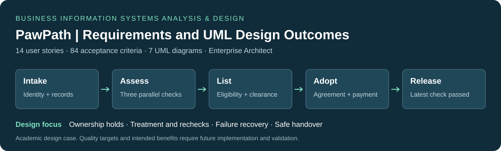

# PawPath | Business Information Systems Analysis & Design

**Requirements analysis · Business process modelling · UML · Domain modelling · Enterprise Architect · Acceptance criteria**

How can an animal shelter coordinate intake, welfare assessments and adoption without listing an ineligible animal or releasing one before its final health check?

PawPath translates that business problem into **14 user stories, 84 acceptance criteria and seven connected UML diagrams**. The design follows an animal from arrival through medical clearance, application assessment, adoption and physical release, with explicit responsibilities, decision conditions and exception paths.

**[Case study & outcomes](docs/case-study.md) · [Business scope](docs/business-case.md) · [Requirements](docs/requirements.md) · [UML gallery](docs/model-gallery.md) · [繁體中文](README.zh-TW.md)**



**Context:** academic design case for BISM7255 at The University of Queensland. This portfolio presents the revised analysis and design package dated 27–28 October 2026. It demonstrates specification and modelling work; PawPath implementation, operational improvements and user acceptance results are outside this repository's evidence.

## Completed analysis and design

| Deliverable | Result | Project evidence |
| --- | --- | --- |
| Requirements specification | Seven functional and seven non-functional user stories, each with six acceptance criteria: **84 criteria** in total | [Requirements catalogue](docs/requirements.md), [criterion dataset](analysis/acceptance-criteria.csv) |
| Process and interaction models | Two end-to-end workflows represented through **two activity and two sequence diagrams**, including parallel work, decisions and recovery paths | [UML gallery](docs/model-gallery.md) |
| Domain and lifecycle models | **11 domain classes and 11 persistent Animal states** connect stored information to permitted business transitions | [Class and state models](docs/model-gallery.md) |
| Integrated design package | **Seven UML diagrams** covering system scope, business processes, interactions, lifecycle and domain structure; functional stories mapped to their principal models | [Requirement traceability](docs/traceability.md) |
| Model validation records | Completed EA integrity check with no problems found; recorded UML validation with **0 errors and 0 warnings** on a matching model copy | [Validation evidence and scope](docs/evidence/README.md) |

The resulting specification makes listing eligibility, adoption finalisation and physical release separate, reviewable decisions. The [case study](docs/case-study.md) explains the business problem, completed deliverables and design outcomes.

## Analysis methods and technical evidence

| Method | Application in the completed design | Evidence |
| --- | --- | --- |
| Business requirements analysis | Turned a narrative case into role-based goals, required information, prerequisites, failure handling and measurable acceptance conditions | [7 functional + 7 non-functional stories](docs/requirements.md), [84 criteria in CSV](analysis/acceptance-criteria.csv) |
| Stakeholder and system-boundary analysis | Distinguished shelter staff, veterinarians, council officers, adopters and an external registry; separated physical work from recorded system outcomes | [Business scope and responsibilities](docs/business-case.md), [use case diagram](assets/diagrams/UC_full.png) |
| Business process modelling | Modelled parallel assessments, synchronisation, statutory holds, treatment loops, unsuccessful applications and recovery paths | [Two activity diagrams](docs/model-gallery.md#activity-diagrams) |
| Behavioural system design | Connected process steps to actor/system messages and persistent lifecycle states | [Two sequence diagrams](docs/model-gallery.md#sequence-diagrams), [state machine](assets/diagrams/SM_full.png) |
| Object-oriented analysis | Defined 11 domain classes with typed attributes, operations, relationships, inheritance and multiplicities | [Domain model](docs/model-gallery.md#class-diagram) |
| Quality requirements and traceability | Specified access, privacy, performance, recovery, usability, integrity and accessibility; mapped functional stories to models | [Traceability](docs/traceability.md), [quality targets](docs/requirements.md#non-functional-requirements) |
| Model review and technical communication | Revised inconsistent rules, made long diagrams readable, and retained native-tool validation evidence | [Review decisions](docs/design-decisions.md), [evidence and limits](docs/evidence/README.md) |

## Three decisions that matter

**Completed assessments do not automatically mean an eligible animal.** Health, ownership and behaviour checks can run independently. Their join establishes completion; unresolved treatment, an active ownership hold or unsuitable behaviour still blocks public listing.

**Adoption and physical release are separate business events.** A compatible meeting, signed agreement and confirmed payment permit adoption finalisation. The latest medical check then controls physical release. A new health concern moves the animal into `Release Paused` while preserving the adoption record.

**Requirements describe failure and recovery as well as success.** Incomplete applications return for correction, unsuccessful matches restore availability, and repeated finalisation requests must return the existing placement. These rules connect acceptance criteria to process, state and data responsibilities.

[Design rationale and trade-offs](docs/design-decisions.md)

## UML model results

| View | Question answered | Supplied model evidence |
| --- | --- | --- |
| Use case | Who needs which system behaviours? | 28 use cases; 10 include and 7 extend relationships |
| Activity 1 / 2 | Who performs the work, in which order, with which parallel and exception paths? | Intake-to-clearance and application-to-placement; 30 actions each |
| Sequence 1 / 2 | What information passes between actors and PawPath? | Four lifelines each; 32 and 42 messages |
| State machine | Which lifecycle transitions are allowed? | 11 persistent Animal states |
| Class | Which information and responsibilities support those rules? | 11 domain classes |

The [gallery](docs/model-gallery.md) contains seven complete Enterprise Architect exports and 12 enlarged reading panels. Counts above are documented in the supplied revision and verification records; the public check does not reopen the native model.

## My responsibility

I was responsible for the **requirements analysis, user stories and acceptance criteria, UML modelling, system design decisions and report preparation** for PawPath. The original coursework report retains its two-student byline. Individual responsibilities and substantive ChatGPT/Codex assistance with the revised package are documented in the [contribution and authorship record](docs/my-contribution.md).

## Evidence and reproducibility

The supplied Enterprise Architect records show a completed **Report Only integrity check with “No problems found”**, and **UML validation with 0 errors and 0 warnings** on a validation copy whose recorded SHA-256 matches the supplied model. All 12 listed rule groups are enabled in the retained screenshot. These are native-tool results for that snapshot, with a defined scope; see [evidence and limitations](docs/evidence/README.md).

To verify the public files and requirement inventory using Python 3.10+ and its standard library:

```bash
git clone https://github.com/1121eason/UQxPawPath-SystemsAnalysisDesign.git
cd UQxPawPath-SystemsAnalysisDesign
python3 scripts/verify_portfolio.py
```

This verifies file hashes, retained source evidence, requirement IDs and internal links. It does not execute PawPath or rerun Enterprise Architect validation.

## Project documentation

The [case study and design outcomes](docs/case-study.md) present the completed analysis in context. Supporting documents provide the [business scope](docs/business-case.md), [design rationale](docs/design-decisions.md), [requirement-to-model traceability](docs/traceability.md) and [validation evidence](docs/evidence/README.md).

**Portfolio owner:** Yi-Cheng Lee (Eason) · University of Queensland academic project. Original editable files, full reports and the assignment brief are retained in an owner-only private archive. Student identifiers and course teaching materials are excluded from this public repository. [Attribution and usage](NOTICE.md).
