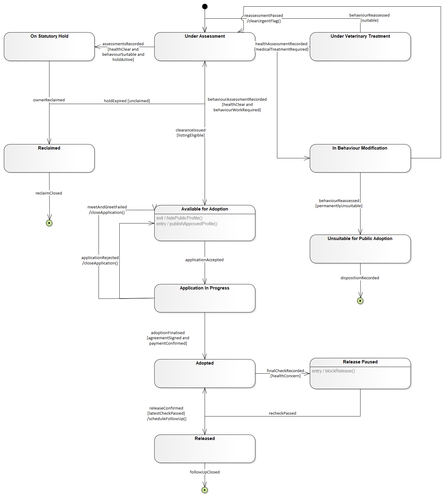

# PawPath | Case Study and Design Outcomes

[Project overview](../README.md) · [繁體中文](../README.zh-TW.md) · [UML models](model-gallery.md)

## Case context and business objective

PawPath is a proposed animal shelter and adoption management system developed for a University of Queensland Business Information Systems Analysis and Design assignment. The case covers two connected workflows: **animal intake to medical clearance** and **adoption application to placement**.

The central business problem is coordinating decisions made by shelter staff, veterinarians, trained behavioural staff, council officers and prospective adopters. An animal may have a completed health assessment while an ownership hold remains active, or an adoption may be finalised before a new health concern prevents physical release. The design must retain those distinctions across requirements, processes, lifecycle states and records.

The objective of the analysis was to turn that narrative into a consistent specification: who performs each activity, what evidence is required, which conditions permit progression, and how the process handles incomplete information or an unsuccessful outcome.

## Completed assignment deliverables

| Deliverable | Completed result | Evidence |
| --- | --- | --- |
| Functional requirements | **7 user stories and 42 acceptance criteria** covering intake, health, ownership, behaviour, listing, application assessment, adoption and release | [Functional requirements](requirements.md#functional-requirements) |
| Non-functional requirements | **7 user stories and 42 acceptance criteria** covering access, privacy, performance, recovery, usability, integrity and accessibility | [Quality requirements](requirements.md#non-functional-requirements) |
| System scope model | **1 use case diagram**, with 28 use cases, actor generalisation, mandatory behaviour and conditional extensions | [Use case diagram](../assets/diagrams/UC_full.png) |
| Business process models | **2 activity diagrams** showing responsibility, parallel assessments, synchronisation, decisions and exception paths | [Activity diagrams](model-gallery.md#activity-diagrams) |
| Interaction models | **2 sequence diagrams**, each with four lifelines, plus explicit calls, returned data and combined fragments | [Sequence diagrams](model-gallery.md#sequence-diagrams) |
| Lifecycle model | **1 state machine with 11 persistent Animal states**, including Adopted, Release Paused and Released | [Animal lifecycle](../assets/diagrams/SM_full.png) |
| Domain model | **1 class diagram with 11 domain classes**, typed attributes, operations, generalisation, compositions and multiplicities | [Class diagram](model-gallery.md#class-diagram) |
| Traceable design documentation | Functional stories mapped to their principal models and acceptance gates; requirements also available in CSV and JSON | [Traceability](traceability.md), [criterion dataset](../analysis/acceptance-criteria.csv) |

Together, these artefacts form a requirements and UML design package with **14 stories, 84 acceptance criteria and seven diagrams**. The deliverables specify a proposed system; they do not represent a deployed application or measured operational benefits.

## Analysis findings and design responses

### Assessment completion and listing eligibility

Health, ownership and behavioural assessments can proceed independently. Their completion must be synchronised before combined review, while each outcome still determines eligibility. The design therefore joins the assessment branches, then retains treatment, ownership-hold and behavioural conditions as explicit barriers to public listing.

This rule appears in FUS2–FUS4, the intake activity and sequence diagrams, the Animal lifecycle and the supporting domain fields. It demonstrates process analysis that considers both workflow coordination and the meaning of the resulting information.

### Adoption finalisation and physical release

A compatible meeting, signed agreement and confirmed payment permit adoption finalisation. Physical handover remains subject to the latest medical check. The design represents **Adopted** and **Released** as separate states and introduces **Release Paused** for a subsequent health concern.

The resulting model preserves the adoption record while blocking departure until treatment and a new examination resolve the concern. `AdoptionRecord` includes `latestMedicalCheckPassed`, `releaseStatus` and `releasedAt` to support this distinction. FUS6 and FUS7 connect the rule to the activity, sequence, state and class views.

### Explicit ownership of clinical decisions

`MedicalRecord.urgentTreatmentRequired` records a veterinarian's judgement that delay risks immediate deterioration. A true value requires a reason and treatment plan. Reassessment and veterinary authorisation are required before the urgent flag is cleared.

This makes the decision owner, required information and clearance condition explicit. PawPath records and applies the clinical outcome; diagnosis remains a veterinary responsibility.

### Exceptions and recovery as part of the specification

Incomplete applications return for correction before suitability review. Unsatisfactory checks and incompatible meetings record their outcomes and restore availability. Treatment and medical rechecks form recovery loops. Repeated finalisation requests must return the existing adoption record.

These paths extend the specification beyond successful completion. They connect process modelling to data integrity, understandable application outcomes and consistent lifecycle transitions.

## Modelled placement outcome

The placement design follows a defined sequence of business events:

1. Satisfactory suitability checks permit a supervised meet-and-greet.
2. Compatibility enables agreement signing and payment confirmation.
3. Both prerequisites allow finalisation of one adoption record and the transition to Adopted.
4. A failed latest health check pauses release and requires treatment and reassessment.
5. A passed check permits release confirmation and follow-up scheduling.

The state machine below presents the lifecycle outcome, including recovery and terminal paths. The same release rule can be traced from FUS7 acceptance criteria to process actions, messages and stored information in the [requirement-to-model example](traceability.md#worked-example-fus7-final-medical-release).

## Professional capabilities demonstrated

| Capability and method | Application in the completed work | Technical evidence |
| --- | --- | --- |
| Business requirements analysis | Converted the case into role-based goals, required information, prerequisites and specific acceptance conditions | 14 user stories; 84 identified criteria |
| Stakeholder and scope analysis | Distinguished human responsibilities, system behaviour and the read-only external registry interaction | Actors, system boundary and responsibility lanes |
| Business process modelling | Represented concurrent work, joins, decisions, holds, treatment loops and unsuccessful applications | Activity actions, guards, forks, joins and merges |
| Behavioural systems analysis | Connected process behaviour to exchanged information and persistent states | Sequence lifelines, calls, replies, fragments, events and state guards |
| Object-oriented domain analysis | Assigned data and operations to domain concepts and represented their relationships | 11-class model with visibility, data types, inheritance and multiplicities |
| Quality specification | Defined workloads, response percentiles, recovery objectives, access boundaries and integrity conditions | Seven non-functional stories with proposed measurable targets |
| Cross-model review and traceability | Aligned listing and release conditions across requirements and UML views | Functional traceability matrix and documented design rationale |
| Enterprise Architect and model documentation | Produced native model exports and retained the corresponding integrity and UML validation records | Seven full PNG exports, enlarged panels and native-tool evidence |

## Validation results and evidence scope

The retained Enterprise Architect records show a completed Report Only integrity check with **No problems found**. UML validation completed with **0 errors and 0 warnings** on a validation copy whose recorded SHA-256 matches the supplied model. The supplied static verification record contains **103 passing checks** covering selected model structure, references and requirement counts.

These results document checks on the revised model snapshot. Business semantics, diagram readability and implementation behaviour require their own review. Performance, availability, recovery and accessibility thresholds are proposed acceptance targets. The [evidence record](evidence/README.md) identifies what was checked and what remains untested.

## Personal responsibility and project context

I was responsible for the requirements analysis, user stories and acceptance criteria, UML modelling, system design decisions and report preparation. The original coursework report retains its two-student byline. Substantive ChatGPT/Codex assistance with the revised model and documentation is described in the [contribution statement](my-contribution.md).

The revised package is dated 27–28 October 2026. Original editable files and full reports are preserved in a private archive; the public materials present the case, completed analysis, design outcomes and supporting evidence.
