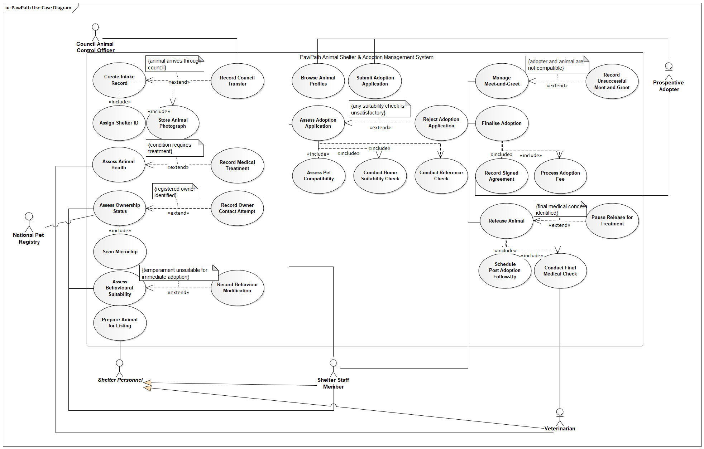
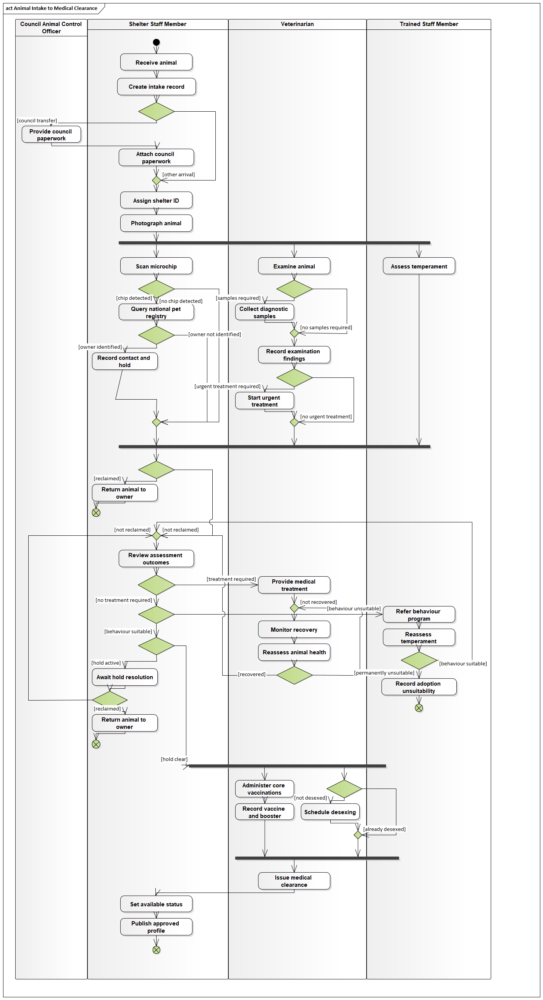
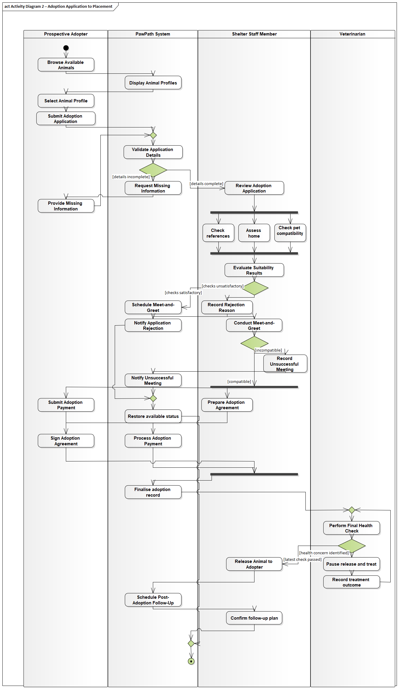
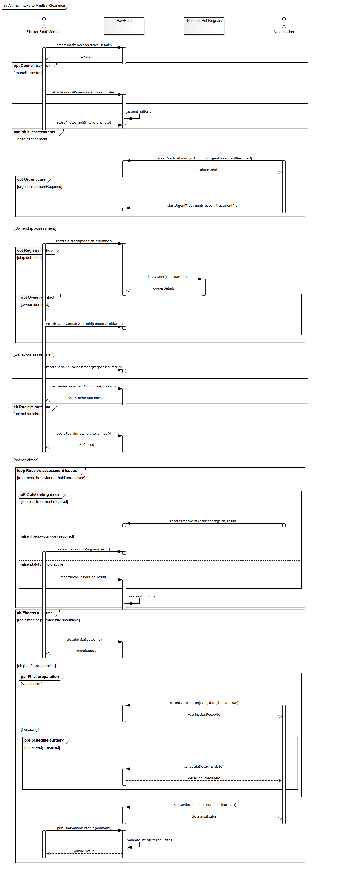
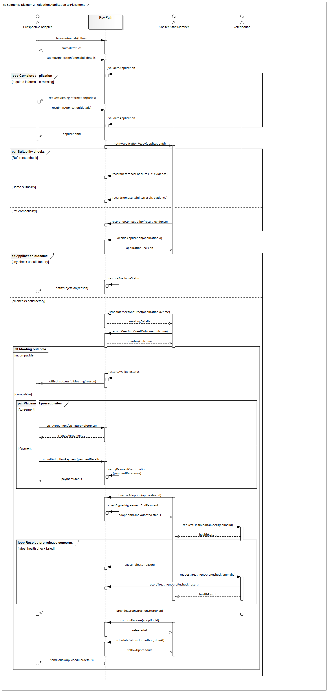
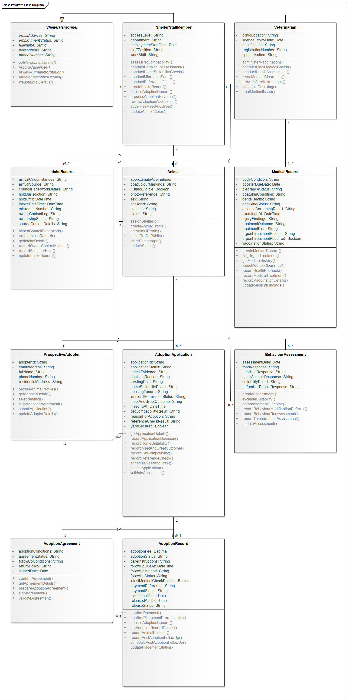

# Enterprise Architect model gallery

[Back to portfolio](../README.md)

Seven full diagrams and 12 reading panels are preserved byte-for-byte from the supplied package. Full images are native Enterprise Architect PNG exports. Panels are supplied crops/enlargements with repeated headings for readability; they are not additional UML models.

Click a full image to inspect it at its original size. Long models also have linked reading panels.

## Use case diagram

### UC — Use case and system boundary

Actors, generalisation, mandatory behaviour and conditional extensions.

[Open full diagram](../assets/diagrams/UC_full.png)

## Activity diagrams

### AD1 — Animal intake to medical clearance

Responsibilities, parallel assessments, treatment, hold resolution and listing eligibility.

[Open full diagram](../assets/diagrams/AD1_full.png)

[Reading panel 1](../assets/diagrams/AD1_part1.png) · [Reading panel 2](../assets/diagrams/AD1_part2.png)

### AD2 — Adoption application to placement

Validation, suitability checks, agreement/payment prerequisites and final release.

[Open full diagram](../assets/diagrams/AD2_full.png)

[Reading panel 1](../assets/diagrams/AD2_part1.png) · [Reading panel 2](../assets/diagrams/AD2_part2.png)

## Sequence diagrams

### SD1 — Intake interactions

Staff, PawPath, registry and veterinarian; parameters, returned data and combined fragments.

[Open full diagram](../assets/diagrams/SD1_full.png)

[Reading panel 1](../assets/diagrams/SD1_part1.png) · [Reading panel 2](../assets/diagrams/SD1_part2.png) · [Reading panel 3](../assets/diagrams/SD1_part3.png)

### SD2 — Placement interactions

Adopter, PawPath, staff and veterinarian; application correction, alternatives and rechecks.

[Open full diagram](../assets/diagrams/SD2_full.png)

[Reading panel 1](../assets/diagrams/SD2_part1.png) · [Reading panel 2](../assets/diagrams/SD2_part2.png) · [Reading panel 3](../assets/diagrams/SD2_part3.png)

## State machine

### SM — Animal lifecycle

Eleven persistent states; listing visibility, paused release and terminal outcomes.

[Open full diagram](../assets/diagrams/SM_full.png)

## Class diagram

### CL — PawPath domain model

Eleven classes, typed attributes, operations, inheritance, compositions and multiplicities.

[Open full diagram](../assets/diagrams/CL_full.png)

[Reading panel 1](../assets/diagrams/CL_part1.png) · [Reading panel 2](../assets/diagrams/CL_part2.png)

## Readability and interpretation

The full exports preserve the submitted revision snapshot. Some class connector endpoints and multiplicities are crowded. Consult the enlarged panels and native model for detailed review; a zero-warning tool result does not establish complete visual clarity or semantic correctness.
